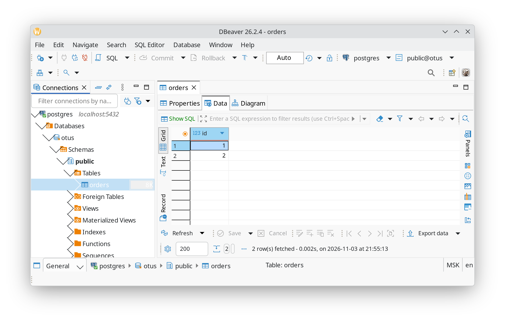

Выполним развертывание на операционной системе Ubuntu 26.04 с уже установленным docker. Используем docker compose:
```yaml
services:

  postgres:
    image: postgres:18.6
    environment:
      POSTGRES_DB: otus
      POSTGRES_USER: postgres
      POSTGRES_PASSWORD: postgres
    # Для подключения из других контейнеров.
    networks:
      - postgres_network
    # Для подключения извне контейнера.
    ports:
      - 5432:5432
    # Данные сохраняем в текущем каталоге проекта.
    volumes:
      - ./data:/var/lib/postgresql
    healthcheck:
      test: ["CMD-SHELL", "pg_isready -d $${POSTGRES_DB} -U $${POSTGRES_USER}"]
      interval: 3s
      timeout: 1s
      retries: 5

networks:
  postgres_network:
    driver: bridge
```

Запустим:
```sh
$ docker-compose up -d
[+] up 2/2
 ✔ Network hw01-install_postgres_network Created            0.9s
 ✔ Container hw01-install-postgres-1     Started            1.0s
```

Подключимся к базе, создадим таблицу и добавим данные:
```sh
$ docker run -it --network hw01-install_postgres_network -e PGPASSWORD=postgres --rm alpine/psql:18.6 -h postgres -d otus -U postgres
psql (18.6)
Type "help" for help.

otus=# create table orders(id int);
CREATE TABLE
otus=# insert into orders values (1), (2);
INSERT 0 2
otus=# 
```

Подключимся с внешнего клиента и проверим содержимое таблицы:


Перезапустим контейнер:
```sh
$ docker-compose down && docker-compose up -d
[+] down 2/2
 ✔ Container hw01-install-postgres-1     Removed            0.8s
 ✔ Network hw01-install_postgres_network Removed            0.8s
[+] up 2/2
 ✔ Network hw01-install_postgres_network Created            0.5s
 ✔ Container hw01-install-postgres-1     Started            1.1s
```

Проверим, что данные сохранились:
```sh
$ docker run -it --network hw01-install_postgres_network -e PGPASSWORD=postgres --rm alpine/psql:18.6 -h postgres -d otus -U postgres
psql (18.6)
Type "help" for help.

otus=# select * from orders;
 id 
----
  1
  2
(2 rows)

otus=# 
```